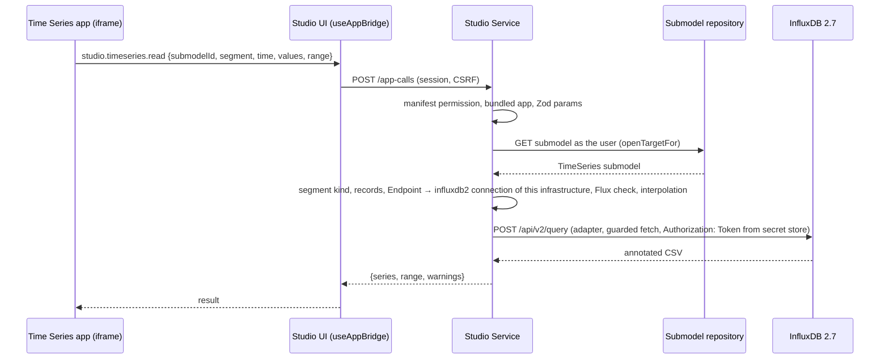

# Time series plan: the Time Series Data view in Studio

- Status: Implemented 2026-10-19 (see [implementation status](#implementation-status))
- Date: 2026-10-19
- Depends on: the app platform of [MVP-3](mvp-3-plan.md), bundled apps
  ([ADR 0023](../adr/0023-bundled-first-party-apps.md)), the capability bridge
  ([ADR 0018](../adr/0018-capability-bridge-and-authorization.md)),
  infrastructure secrets ([ADR 0020](../adr/0020-infrastructure-templates-registries-and-sync.md),
  [ADR 0025](../adr/0025-client-certificates-for-infrastructures.md),
  [ADR 0037](../adr/0037-declared-infrastructures-export-and-import.md)) and a
  new ADR 0040 for connections on infrastructures (phase A)
- Scope decision gate: IDTA 02008 *Time Series Data* 1.1; InfluxDB 2.7
  (Flux, `/api/v2/query`) for LinkedSegments, as the first connection type; a
  visual port of the BaSyx AAS Web UI plugin as a bundled submodel view, not a
  standalone product; the database token never leaves the Studio Service
- Requirements: CON-001 to CON-006 ([requirements](../requirements.md));
  [MVP-7](mvp-7-plan.md) adds the generic `http` connection type on the same
  core

## Goal

A user opens a submodel with the semantic ID
`https://admin-shell.io/idta/TimeSeries/1/1` and sees the same view as in the
BaSyx AAS Web UI. They pick a segment, a time variable and values, a time
range and an optional auto refresh, and get a line, area, scatter, histogram,
gauge or display-field chart. LinkedSegments read from InfluxDB with a token
that an administrator configured once. The token never reaches the browser,
the app iframe or the AAS.

> admin adds a connection of type `influxdb2` to an infrastructure (URL and
> token, or `env:` / `file:` reference when hosted) → user opens a shell → *Time Series Data*
> appears in the submodel's visualization tab and as an overview widget →
> *Segment: LinkedSegment*, *time*, *Temperature*, *Last 15m*, *Auto refresh
> 30 s* → *Fetch data* → a line chart refreshes every 30 s

## Starting point

### BaSyx AAS Web UI

Paths are relative to `basyx-aas-web-ui/aas-web-ui/src`.

- **Plugin:** `components/Plugins/Submodels/TimeSeries_v1_1.vue` (about 1,040
  lines). It does all fetching and parsing itself. Helpers live in
  `TimeSeries/TimeRangeSelector.vue`, `AutoRefreshSelector.vue`,
  `timeRange.ts` and `autoRefresh.ts`.
- **Charts:** ApexCharts 7.1 through the imperative API, in
  `components/Widgets/{LineChart,AreaChart,ScatterChart,Histogram,Gauge,DisplayField}.vue`,
  `temporalChartOptions.ts` and `composables/ChartHandling.ts`.
- **Selection:** a segment is identified by the semantic ID of
  `InternalSegment`, `LinkedSegment` or `ExternalSegment` (`…/Segments/<Kind>/1/1`).
  Everything else is found by idShort, ignoring case: `Segments`,
  `Metadata.Record`, `Records`, `Endpoint`, `Query` and `Data`. Units come
  from the concept descriptions of the Metadata records.
- **LinkedSegment:**
  - The browser `POST`s the `Query` value to the `Endpoint` value, for example
    `http://localhost:8086/api/v2/query?org=basyx`.
  - It sends the headers `Authorization: Token …`, `Content-Type:
    application/vnd.flux` and `Accept: application/csv`.
  - Before sending, it replaces the first `{{y-value}}` with the first selected
    value, and replaces `v.timeRangeStart`, `v.timeRangeStop` and
    `v.windowPeriod` (360 points per graph).
  - It parses InfluxDB's annotated CSV by table, using `_time`, `_value`,
    `_field` and `topic`.
- **Token:** there is one global `INFLUXDB_TOKEN`. The container entrypoint
  writes it into the JavaScript bundle with `sed` and prints it to the log.
  Without the token, the user types it into a plain *API Token* field. Every
  browser user can read the token.
- **ExternalSegment:** the browser `GET`s the `Data` file (an attachment or an
  absolute URL) and parses it as simple CSV, with columns named after the
  record idShorts.
- **InternalSegment:** the browser reads `Records` from the submodel itself.

### Studio

- **App views:** bundled apps contribute `submodelViews` by exact semantic ID.
  They appear in the element drawer's visualization mode and as overview
  widgets. They run in a sandboxed iframe whose CSP allows `connect-src` to
  the app's own files only, so an app cannot call InfluxDB or Studio
  directly.
- **Capabilities:** every capability is a `POST /app-calls`. The server
  checks it against the installed manifest and validates its parameters with
  Zod. The server runs AAS methods as the user. `studio.containers.*` is a
  server-run family that only bundled apps may use
  (`server/lib/apps/calls.ts`, `server/utils/containers.ts`). This is the
  pattern to follow.
- **Secrets:** infrastructure secrets are stored in one of two ways:
  - hosted deployments use `env:NAME` / `file:/path` references;
  - desktop stores the value encrypted with the data key (AES-GCM, with the
    purpose as AAD).

  The API returns summaries only, never values. Exports strip secrets.
  Declared infrastructures (`STUDIO_INFRASTRUCTURES_FILE`) accept references
  only (`shared/contract/infrastructure.ts`, `server/lib/infrastructures.ts`).
- **Outbound calls:** every outbound call goes through `createGuardedFetch`,
  which applies:
  - an origin allowlist;
  - private-network policy, rechecked at connect time;
  - no redirects;
  - a timeout and a size cap.

  Credentials are injected there, as `TargetHttp` does with `Bearer`.
  `security.md` forbids a generic proxy and renderer-supplied upstream URLs.
- **Gaps:**
  - nothing in the repository mentions InfluxDB yet;
  - Studio has no chart library;
  - apps can read File contents (`studio.ui.readFile`, ADR 0038), but not
    concept descriptions;
  - `studio.http` (APP-008) is only designed.

## How the token is handled

The BFF injects the token. The **Studio Service** reads the segment from the
AAS itself as the signed-in user, then checks the segment's `Endpoint` against
the connections of the **same infrastructure** whose type serves time series. It runs the query
with a guarded fetch that adds `Authorization: Token …`, and returns parsed
series to the app.

The app never sends a URL or a query. It sends only the submodel, the segment
idShort, the selected record idShorts and the time range. This rules out three
attacks:

- a browser user reading the token;
- an app pointing the token at a host of its choice;
- an AAS author on another infrastructure making Studio send this
  infrastructure's token to their server.



### Threats and answers

| Who | Could try to | Answer |
| --- | --- | --- |
| Browser user | Read the token | The token exists only in the secret store and in the BFF's outbound request. It is not returned by any API, and it is not in the bundle, the logs or exports. The infrastructure API returns `{kind, ref}` summaries only. |
| App (bundled or installed) | Send the token to another host, or run its own Flux | The method takes no URL and no query. The CSP blocks direct calls. In v1 the permission is reserved for bundled apps, as with `studio.containers`. |
| AAS author | Set `Endpoint` to their own server | The token is used only if the endpoint's origin is a connection's URL or one of its aliases, on the same infrastructure the submodel was read from. The request always goes to the configured URL. Redirects are never followed. |
| AAS author | Write a harmful Flux query (`to()`, `http.post`, `sql.from`, secrets) | Two layers. The documented requirement is a **read-only token limited to the needed buckets**; this is the real boundary. The BFF adds a Flux check (allowed imports, no `to`, `http`, `sql` or `secrets`) as defence in depth. |
| Browser user | Inject Flux through the selected values | Each value must be the idShort of a `Metadata.Record` of the submodel the BFF read. idShorts cannot contain quotes or Flux syntax. |
| Anyone | Use Studio as a load generator | The BFF applies a timeout (15 s), a response cap (20 MiB) and a point cap per series. Auto refresh has a 5 s minimum in Studio. |

## Decisions

Decided on 2026-10-19.

### Connections

Connections are a generic part of an infrastructure. Time series is their
first use, and [MVP-7](mvp-7-plan.md) adds the `http` type with declared
operations. A connection describes *how to reach and authenticate* to a
service. What may be done with it is decided by a type-specific **adapter** in
the Studio Service. A connection never serves as a generic proxy.

| # | Topic | Proposal |
| --- | --- | --- |
| C1 | Where connections live | An optional list `connections` on an **infrastructure** (CON-001). It is not a new AAS endpoint type: `endpointTypes` and `templateRules` stay AAS-only. A credential configured for one infrastructure is used only for content read from it (CON-003). |
| C2 | Entry | `{ key, type, url, aliases?, auth, settings?, allowPrivateNetwork? }`. `type` names the API the service speaks, not the transport protocol, because the URL scheme already gives that; it selects the adapter and the schema of `settings` (a Zod discriminated union on `type`). `url` is how the Studio Service reaches the service, for example `http://influxdb:8086`. `aliases` are the origins under which AAS content refers to it, for example `http://localhost:8086`. |
| C3 | Authentication | `auth` is a discriminated union on `scheme`: `none`, `token`, `bearer`, `header`, `basic`, `oauth2ClientCredentials` and `delegatedUser` (CON-007; token exchange as in MVP-7 K5a). Each adapter lists the schemes it accepts; `influxdb2` accepts `token`. Secret fields use `secretInputSchema` as is. Hosted deployments use `env:NAME` / `file:/path`. Desktop stores a `value` encrypted with the purpose `infrastructures.connection_secret`. Summaries show `{kind, ref}` only. Omitting a secret on update keeps it. A client certificate (ADR 0025) can be added per connection later. |
| C4 | Adapters | A registry in `server/lib/connections/` maps `type` to an adapter with its `settings` schema, accepted auth schemes, the purposes it serves, and `test()`. `influxdb2` serves `timeseries`, has settings `{ organization? }`, and its test runs `GET /health` and `buckets() \|> limit(n: 1)`. Capabilities are named by purpose, so `studio.timeseries.read` works unchanged when another database type gets an adapter. |
| C5 | Storage | Migration `0007_infrastructure_connections.sql` adds `connections` (jsonb, without secrets) and `connection_secrets_ciphertext` (one encrypted map from key to secrets) to `infrastructures`. Changes bump `revision`. |
| C6 | Declared infrastructures | YAML and `STUDIO_INFRASTRUCTURES` accept `connections` with secret references only (ADR 0037). Export strips secrets like client secrets; import asks for them again. |
| C7 | Network policy | The guarded fetch policy allows `url`'s origin only. `allowPrivateNetwork` follows the rule of infrastructures: the entry's flag AND the deployment's `STUDIO_PRIVATE_NETWORK_TARGETS`. Hosted deployments with a database in the Compose network need both. |
| C8 | Admin UI | `InfrastructureDialog.vue` gets a *Connections* section. Each entry has a type select, URL, aliases, the type's settings, write-only secret fields (`type=password`, showing *Stored* or `env:NAME`) and *Test connection* (CON-005). The test result is shown without the secret. Managed infrastructures are read-only, as today. |
| C9 | No global variable | There is no `STUDIO_INFLUXDB_TOKEN`. The Web UI's single token maps to one `influxdb2` connection on the infrastructure that holds the TimeSeries submodels. The deployment docs show the migration. |

### Capability

| # | Topic | Proposal |
| --- | --- | --- |
| K1 | Permission | `studio.timeseries.read` (manifest schema enum, `protocol.ts`, `methodPermissions`). In v1, `authorizeAppCall` reserves it for `installation.bundled`. Opening it to installed apps later needs an install-time warning (`security.md`, data egress). |
| K2 | Method | `studio.timeseries.read({ submodelId, segment, time, values, range: {start, stop}, maxPoints? })` returns `{ kind, range, series: [{ key, unit, points: [[epochMs, number]] }], warnings: [{ code, params }] }`. All three segment kinds use it, so parsing and limits live in `server/lib` and are unit-tested once. |
| K3 | Checks | The submodel must have the TimeSeries semantic ID. The segment is identified by its semantic ID. `time` and `values` must be idShorts of `Metadata.Record`. `range` is RFC 3339, `start < stop`, at most 5 years. |
| K4 | LinkedSegment | The BFF picks the connection of this infrastructure whose type serves `timeseries` and whose `url` or alias matches the endpoint origin. With `influxdb2`, the path must end in `/api/v2/query`. Only `org`/`orgID` are kept (`settings.organization` overrides them); the request goes to the connection's `url`. The query is checked by the Flux guard (allowed imports `strings`, `math`, `date`, `array`, `experimental/aggregate`; no `to(`). `{{y-value}}` is replaced **in every occurrence, with one query per selected value**, which fixes the Web UI's "first value only" behaviour. The `v.*` variables are interpolated as in `timeRange.ts`. The CSV parser is ported from `convertInfluxCSVtoArray` and `finalizeDataset`. |
| K5 | ExternalSegment | A `File` holding a relative path is read as an attachment through the target as the user. An absolute URL is allowed only when its origin is one of the infrastructure's endpoints, so it uses the target's credentials. Any other URL is refused with a warning (no generic proxy). The CSV parser handles quoted fields, unlike the Web UI's comma split. |
| K6 | InternalSegment | Read from the submodel that the BFF already loaded. The result has the same shape as the other kinds. |
| K7 | Units | Read in the BFF from the concept descriptions of the records' semantic IDs, and from the records' own `embeddedDataSpecifications` when there are none. No new `studio.aas` method is needed. |
| K8 | Audit | `timeseries.read` with infrastructure, connection key, submodel, segment, query digest (SHA-256, not the text), status and duration. Refusals (endpoint not configured, Flux guard) are always audited. |
| K9 | Desktop workspaces | AASX workspaces have no infrastructure. In v1, Internal segments and attachment-based External segments work there. LinkedSegments show *"No time series database is configured for this file"*. Connections for workspaces wait for a concrete use case. |

### App and look

| # | Topic | Proposal |
| --- | --- | --- |
| U1 | Placement | A bundled submodel view, not a standalone product (see MVP-7 for those): app `apps/time-series` (`org.eclipse.basyx.studio.time-series`), with runtimes `hosted` and `desktop`. It has one `submodelView` for `https://admin-shell.io/idta/TimeSeries/1/1` with columns `{md: 12, xl: 6}`, and permissions `studio.aas.read`, `studio.timeseries.read` and `studio.ui.notifications`. |
| U2 | Visual parity | Same cards, order, controls and charts as the Web UI (see *Design*). The time-range and auto-refresh menus are ported unchanged, including Grafana-style presets and absolute `datetime-local` ranges. |
| U3 | Studio adjustments | No *API Token* field: without a matching connection, an alert reads *"Time series database not configured for `http://localhost:8086`"*. Snackbars become `studio.ui.notify`. All strings are in seven locales (ADR 0026). Vuetify only, no custom CSS. Charts follow the Studio theme through `applyTheme`. The *Fetch data* button is also disabled when no segment, time or value is selected. |
| U4 | Charts | `apexcharts@7.1.0` in the app's own `package.json`, not in Studio's. The CSP already allows the inline styles ApexCharts sets. A new ADR 0041 records the library, as ADR 0034 and ADR 0039 did for the BOM and 3D viewers. |
| U5 | Auto refresh | Uses the same `setInterval` model as the Web UI, with a 5 s minimum. Refresh pauses while the iframe is hidden (`document.visibilityState`). Stale responses are dropped with the Web UI's request counter. |
| U6 | Defaults | 1 minute relative range, auto refresh off, line chart. The first segment is preselected; when the submodel has a record named like `time`, it is preselected as the time variable. *Assumption.* |

## Design

```text
┌ Time Series Data ──────────────────────────────────────────────────────┐
│ Description of the submodel                                            │
├ Preview configuration ─────────────────────────────────────────────────┤
│ Segment       [LinkedSegment                                    ▾ ✕]   │
│ Time value    [time            ▾]   Values  [Temperature, Humidity ▾]  │
│ ⚠ Time series database not configured for http://localhost:8086        │
│                              [🕒 Last 15m ▾][⟳ 30s ▾]                  │
│ ───────────────────────────────────────────────────────────────────    │
│                                                         [Fetch data]   │
├ Preview chart ─────────────────────────────────────────────────────────┤
│ Chart type    [Line chart                                       ▾]     │
│ Interpolation [smooth ▾]                                               │
│  ╭──────────────────────────────────────────────────────────────╮     │
│  │  ~~~~~~~/\~~~~~~~~~~~~/\/\~~~~~~  Temperature [°C]            │     │
│  │  ____/‾‾‾‾\______/‾‾‾‾‾‾‾\_____   Humidity [%]               │     │
│  ╰──────────────────────────────────────────────────────────────╯     │
└────────────────────────────────────────────────────────────────────────┘
```

### Configuration (hosted)

```yaml
version: 1
infrastructures:
  - key: plant
    name: Plant
    template: mono-all
    endpoints:
      - { type: aasEnvironment, url: http://aas-env:8081 }
    security: { mode: unsecured }
    allowPrivateNetwork: true
    connections:
      - key: influx
        type: influxdb2
        url: http://influxdb:8086
        aliases: [http://localhost:8086]
        auth: { scheme: token, token: { ref: env:STUDIO_PLANT_INFLUX_TOKEN } }
        settings: { organization: basyx }
```

### Code structure

- `apps/time-series/`:
  - `studio-app.json`, `package.json` (with apexcharts) and `vite.config.ts`;
  - `ui/src/main.ts`, `App.vue` (port of `TimeSeries_v1_1.vue` without
    fetching), `TimeRangeSelector.vue`, `AutoRefreshSelector.vue`;
  - `charts/{LineChart,AreaChart,ScatterChart,Histogram,Gauge,DisplayField}.vue`,
    with Line and Area merged into one `TimeChart.vue` with a `type` prop;
  - `chartOptions.ts`, `timeRange.ts`, `autoRefresh.ts`, `i18n.ts` and
    `locales/*.json`.
- `packages/studio-sdk/`:
  - permission and method in `protocol.ts`;
  - `client.timeseries.read` in `index.ts`;
  - the manifest schema enum.
- `shared/contract/`:
  - `timeseries.ts` for parameters, result and warnings;
  - `connections.ts` for the connection input and summary, the `auth`
    union and the per-type `settings`; `infrastructure.ts` adds `connections`
    to the infrastructure input;
  - `apps.ts` for `appMethodParamsSchemas`.
- `server/lib/connections/`, with no `nuxt/server` imports:
  - `registry.ts`: adapters by type, with settings schema, auth schemes,
    purposes and `test()`;
  - `auth.ts`: builds request headers from `auth`, using the credential broker
    for `oauth2ClientCredentials`;
  - `influxdb2.ts`: matches the endpoint, builds the request and parses the
    annotated CSV.
- `server/lib/timeseries/`, with no `nuxt/server` imports:
  - `segments.ts`: finds the segment, records, kind and units;
  - `flux.ts`: interpolation of `{{y-value}}` and `v.*`, and the Flux guard;
  - `csv.ts`;
  - `read.ts`: orchestrates the three kinds and enforces limits.
- `server/lib/infrastructures.ts`: stores, resolves, summarizes, exports and
  reconciles connection secrets. `infrastructure-file.ts` handles the YAML.
- `server/utils/timeseries.ts`: the dispatcher, which opens the target with
  `openTargetFor`, resolves the connection and its secret and calls `server/lib/timeseries/read.ts`.
  It is wired into `performAppCall` next to `isContainerMethod`.
- `server/api/studio/v1/infrastructures/[infrastructureId]/connections/[key]/test.post.ts`:
  *Test connection*.
- `app/components/InfrastructureDialog.vue` gets a new section;
  `app/composables/useAppBridge.ts` forwards the new method.
- `server/database/schema.ts` and migration `0007`.

## Phases

| Phase | Content | Done when |
| --- | --- | --- |
| A | ADR 0040 (connections on infrastructures, adapters, credential injection, `studio.timeseries.read`) and ADR 0041 (ApexCharts); updates to `security.md` and `app-platform.md` | ADRs reviewed |
| B | Connections core: contract, adapter registry, migration, secret storage, YAML, export/import, admin section, *Test connection* | Unit tests for storage, summaries, export stripping and the YAML file; the token appears in no API response or log |
| C | `server/lib/timeseries` and the capability (Linked, External, Internal), Flux guard, limits, audit | Unit tests with the Web UI fixtures (`influxdb-samples.ts`, `timeseries-sample-data.ts`), plus foreign endpoint, alias, guard, injection and redirect cases |
| D | `apps/time-series`: ported UI, charts, time range, auto refresh, locales | Component tests ported from the Web UI suite; `pnpm lint`, `pnpm typecheck` and the i18n check pass |
| E | End to end with InfluxDB 2.7 (the Web UI's `examples/TimeSeriesData` setup: Telegraf, MQTT, `TimeSeriesDemo.aasx`), hosted and desktop | A chart with auto refresh in both runtimes; the browser's network log shows no token |
| F | Docs: deployment reference, a Compose example with InfluxDB, migration from `INFLUXDB_TOKEN` | Docs merged |

## Later

- Other databases, as further adapters:
  - InfluxDB 3 (SQL and InfluxQL over `/api/v3/query_sql`);
  - TimescaleDB or PostgreSQL;
  - Prometheus.

  Each adapter has its own query check and parser behind the same capability.
- `studio.timeseries.read` for installed apps, with an install-time warning.
- The `http` connection type with operations that an administrator approved
  for an app ([MVP-7](mvp-7-plan.md)).
- Deployment-wide connections for desktop workspaces (K9).

## Implementation status

Implemented on the `time-series` branch on 2026-10-19. The connections core
is complete for [MVP-7](mvp-7-plan.md): every authentication scheme of
CON-007 works at runtime, so MVP-7 only adds the `http` type, app bindings
and `studio.connections.call`.

| Phase | Status | Evidence |
| --- | --- | --- |
| A | Done | ADR 0040, ADR 0041; `security.md` and `app-platform.md` updated |
| B | Done | Contract, adapter registry, migration 0007, secret storage, YAML, export and import, admin section, *Test connection*. Unit tests (`test/connections`) for storage, summaries, export stripping, the YAML file, every auth scheme's headers, client credentials and token exchange against a fake IdP, forwarding with the audience check, a fake InfluxDB, redirects and foreign origins. In the browser: hosted (references) and desktop (stored values kept on update, stripped from exports) |
| C | Done | `server/lib/timeseries`, the capability and its audit. Unit tests (`test/timeseries`) with the Web UI's fixtures, plus the Flux check, injection through values, foreign endpoints, wrong paths, HTML instead of CSV, limits and the `latest` anchor |
| D | Done | `apps/time-series`; 56 unit tests ported from the Web UI's time range and auto refresh tests plus series preparation; lint, typecheck and i18n check |
| E | Done for hosted | `examples/deployment/time-series` with InfluxDB 2.7, a simulated sensor and a read-only token. In headless Chromium against a dev Studio: all three segments charted in light and dark, auto refresh at 5 s, and the database token in no request or answer of the page. `smoke-test.mjs` checks the stack through the API and runs in CI after the image build. The desktop app was checked through the API in desktop mode, not in Electron |
| F | Done | Deployment guide: connections, the read-only token and the migration from `INFLUXDB_TOKEN` |

Deviations from the decisions above:

- **K2:** `range` also takes `anchor` (`fixed` or `latest`). With `latest`,
  internal and external segments move the range to end at their latest
  point, as the Web UI does for relative ranges; the result's `range` says
  which range the series cover. LinkedSegments followed with T1 of the
  [external apps plan](external-apps-plan.md).
- **K4:** a query without `{{y-value}}` is sent once and its tables are
  matched to the values by key, ignoring case. A query per value may also
  name its only table differently (for example after an MQTT topic).
- **K1:** the app API becomes 0.1.2; MVP-7's methods raise it to 0.2.0 as
  planned.
- **D:** there is no component test setup in the repository, so the Web
  UI's component tests were ported as tests of the logic modules.
- The Web UI's Telegraf and MQTT setup is replaced by a small writer in the
  example, which tags points like Telegraf's MQTT consumer.
